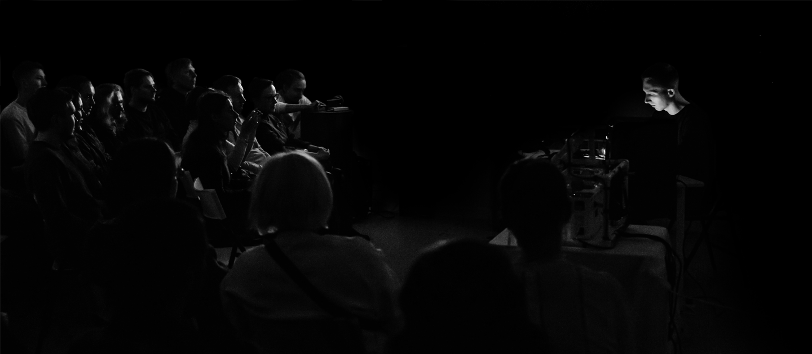

Привет! Я режиссёр и технический дизайнер.

Я окончил мастерскую звукорежиссуры кино. Там мы не просто работали со звуком, а учились режиссуре как способу мышления и анализа: видеть взаимосвязи, выстраивать замысел, создавать целостные, живые истории.

В интерактивных медиа я увидел возможность рассказывать такие истории иначе — создавать целые пространства, в которых человек не просто наблюдает, а действует и через собственный опыт познаёт и мир, и самого себя.

Я начинал как 3D Generalist: работал над мультимедийными проектами, создавал окружение, ставил свет и анимировал персонажей. Позже перешёл к техническому арту и программированию. Сейчас я — Lead Technical Game Designer: проектирую архитектуру систем, пишу игровую логику на C# и координирую команду разработки.

Также я занимаюсь саунд-артом и пишу музыку, работаю с аналоговыми синтезаторами. В 2024 году моя многоканальная композиция «Солнечный ветер» была представлена в галерее «Краснохолмская», а через несколько месяцев я выступил с первым лайв-сетом.

В синтезе мне интересны сложные системы генерации звука и музыки, новые способы формирования тембра и столкновение искусственных звучаний с акустическими. Сейчас я продолжаю этот поиск и разрабатываю собственный синтезатор Kira.
