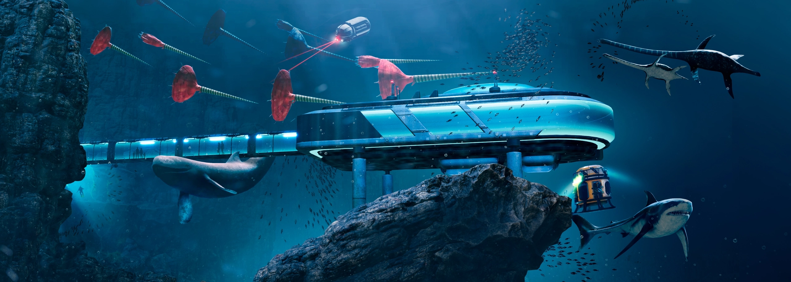

# Океан Юрского периода

*Интерактивная мультимедийная выставка*

**Роль:** 3D Generalist / Lighting Artist

«Океан Юрского периода» — интерактивная выставка о жизни древнего океана в «Москвариуме» (Москва). Главной задачей было создать достоверную и убедительную иллюзию среды: точно передать масштабы обитателей и механику их поведения с учётом технических ограничений рендеринга реального времени.

Выставка состояла из нескольких интерактивных зон. Сначала я работал над зоной «Лаунж»: выстраивал композицию сцены, собирал окружение из 3D-ассетов, настраивал освещение и анимировал персонажей в Unity, создавая акцентные анимационные события.

Затем я перешёл к работе над всем пространством парка: отвечал за освещение, постобработку и звук, формируя целостный образ выставки. Также создавал дополнительные анимации персонажей, которые помогали связать отдельные сцены между собой.

Самое приятное — видеть, что твоя работа вызывает у посетителей искренний эмоциональный отклик: совершенно иначе начинаешь воспринимать и сам проект, и свою роль в нём.

<a href="https://www.behance.net/gallery/122971265/Jurassic-Ocean-Immersive-Experience" target="_blank" rel="noopener noreferrer">Jurassic Ocean Immersive Experience ↗</a>

**Стек:** Unity, Maya
