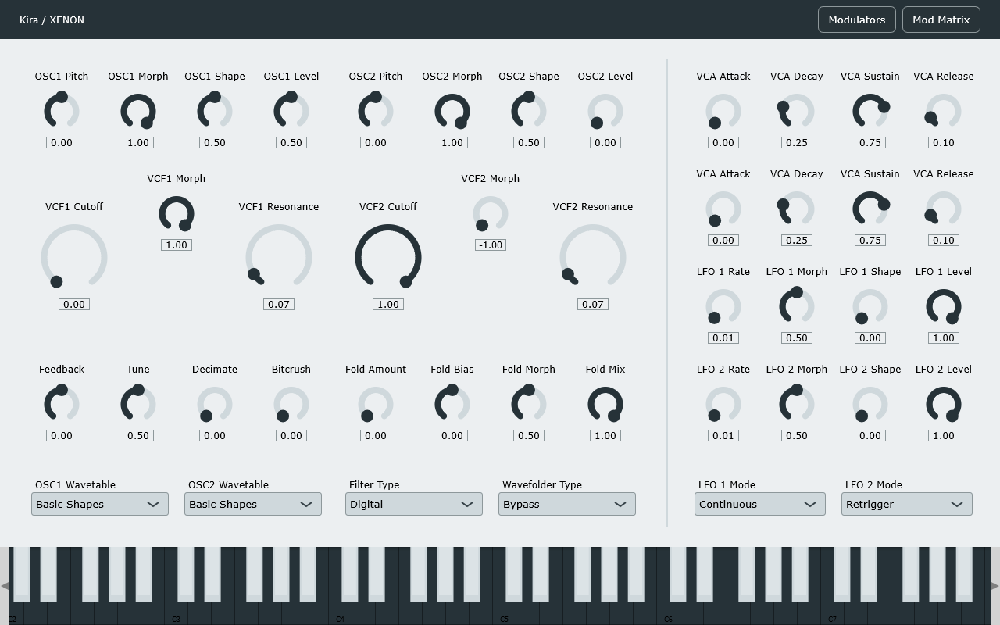

# Kira

*Гибридный синтезатор*

**Роль:** Technical Designer / DSP Engineer

Kira — синтезатор для аппаратной DSP-платформы и полумодульная композиционная среда для саунд-дизайна и саунд-арта.

Kira объединяет инструменты модуляции и управления, вдохновлённые философией West Coast и модульных синтезаторов. Генераторы математических функций, модификаторы форм сигналов и запись пользовательских жестов в реальном времени позволяют создавать сложные звуковые системы и генеративные композиции.

Звуковое ядро синтезатора построено на wavetable-осцилляторах и фильтрах на основе топологии zero-delay feedback. Основной сигнальный тракт включает тональную линию задержки с обратной связью и дополнительные модули обработки и креативного преобразования звука.

Я проектирую высокопроизводительную архитектуру на основе data-oriented design: движок выполняет вычисления per sample на повышенной частоте дискретизации. Это сокращает временной интервал между отсчётами и позволяет минимизировать латентность аудиотракта.

Это особенно важно при синтезе. Глубокая кросс-модуляция на аудиочастотах и работа с тональными линиями задержки требуют высокой временной точности. Более частые вычисления позволяют точнее рассчитывать быстрые изменения сигнала и фазовые сдвиги, возникающие при модуляции и прохождении через линии задержки.

*Отладочный интерфейс с главными параметрами синтеза*

В процессе разработки я исследую математику и физику звука, алгоритмы синтеза и генерации. Главный приоритет — точность и предсказуемость звукового ядра вместе с расширенными звуковыми и композиционными возможностями.

**Стек:** C, C++
